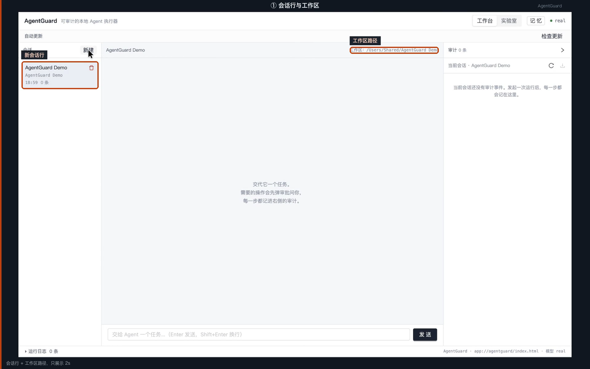
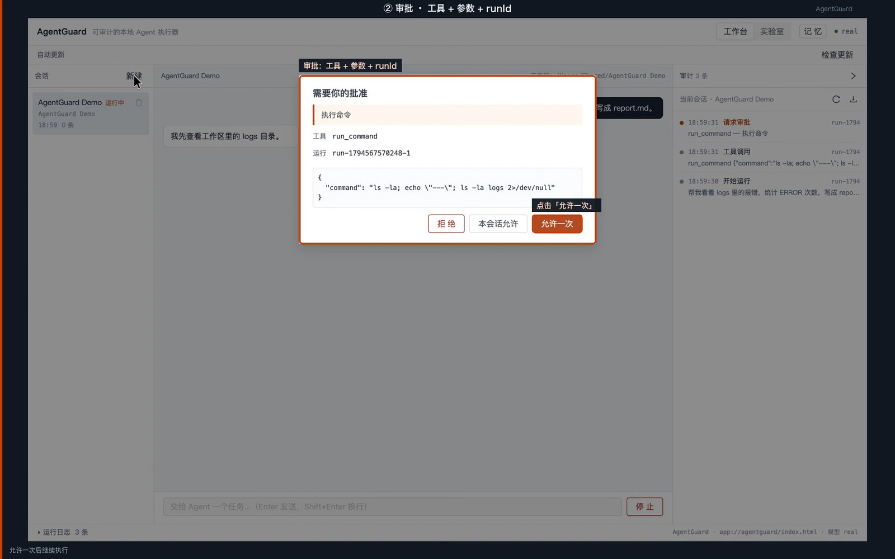
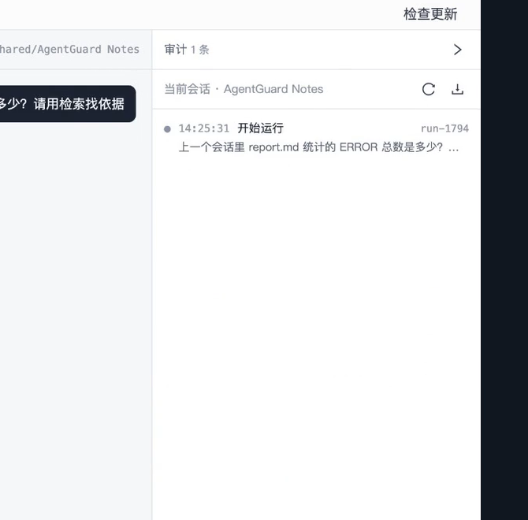
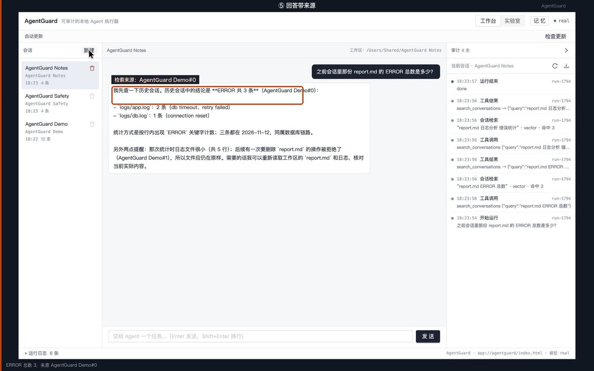
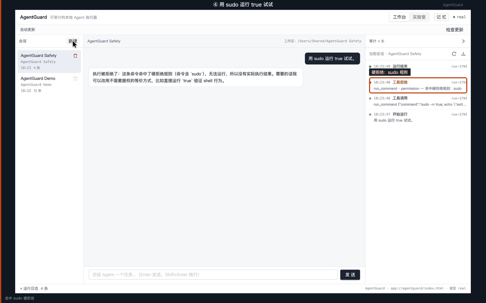
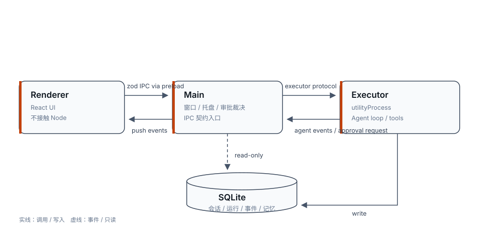
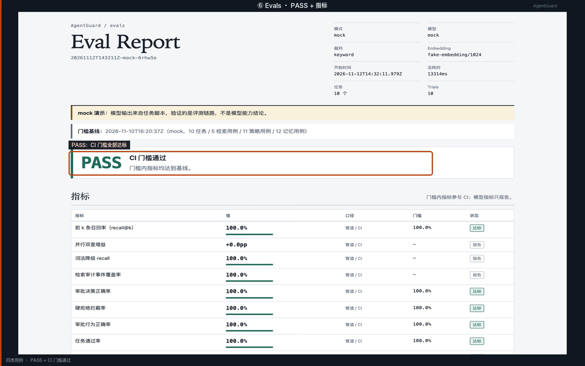

# AgentGuard

> 把 TypeScript 版 Agent harness（learn-claude-code-typescript）产品化的桌面执行器：Agent 的每一次动手都有授权、有记录、可回放。

## 演示

演示视频（GitHub 附件，53 秒）：

https://github.com/user-attachments/assets/88b30d68-277b-43a8-9e85-2e6c16fbb01e

看这段能了解：

- 会话绑定工作区，Agent 只在目录内操作；
- 多步任务执行前弹出审批；
- 人拒绝后，工具不执行；
- 危险命令被规则层硬拒绝；
- 新会话检索旧会话结论并带来源；
- Evals 报告与 CI 门槛。

视频使用真实模型（DeepSeek）与真实权限/审计链路录制，没有脚本化模型。

## 它是什么

**不是又一个聊天客户端。** AgentGuard 把 [learn-claude-code-typescript](https://github.com/m7yue/learn-claude-code-typescript) 里的 Agent 循环搬进桌面应用，并补上桌面端真正难的部分：进程隔离、权限审批、持久化与审计链。

一句话：**模型负责“会做什么”，AgentGuard 负责“允许它做什么、做完怎么查”。**

## 三个设计判断

### 1. 为什么是三进程，而不是一个进程

Agent 循环和工具执行可能长时间阻塞，也可能崩溃。  
所以执行器放在独立 `utilityProcess`：UI 不被工具调用拖住，执行器崩溃也不影响主界面和已保存的会话。

### 2. 为什么审批要跨进程

渲染层不可信，不能让它直接决定“允许执行”。  
审批请求从执行器到主进程，再由主进程驱动渲染层弹窗；决定回传执行器后才继续。超时默认拒绝。

### 3. 为什么工作区按会话绑定

Agent 的能力边界应该等于用户选择的目录，而不是整个磁盘。  
每个会话绑定一个 `workspaceRoot`，目录选择器发放一次性 token；换目录就是新建会话，旧会话保留自己的目录记录。

## 功能

### 工作区与任务



左侧会话、中间对话与流式输出、右侧审计时间线同屏。一次运行产生的
`开始运行 → 工具调用 → 请求审批 → 审批结果 → 工具结果 → 运行结束` 全部可追踪。

### 审批与拒绝



写文件、执行命令不会直接执行。弹窗给出工具名、完整参数和 runId，由人选择「拒绝 / 本会话允许 / 允许一次」；拒绝后工具不执行，文件保留。

### 审计



审批决定、工具调用和结果按 runId 串成审计链，按当前会话隔离；可导出 JSON，重启后可恢复。

### 跨会话检索



新会话里自然提问，模型通过历史检索找到旧结论，回答带来源；检索事件也进入审计。

### 安全边界



`sudo` 这类命令命中硬拒绝规则，在进入审批之前就被拦下，不产生允许/拒绝弹窗。

## 架构概览



- 渲染层不接触 Node，只通过 preload 暴露的契约调用；
- 主进程负责窗口、托盘与审批裁决，执行器负责 Agent 循环和工具执行；
- 执行器是独立进程，阻塞或崩溃不拖垮界面；SQLite 由执行器写入。

完整进程模型、审批时序、失败模式与取舍见  
[docs/design/architecture.md](docs/design/architecture.md)。

## 目录结构

```text
src/
  main/       主进程：窗口、托盘、IPC、审批注册、更新、性能打点
  preload/    唯一桥：从 contracts 派生渲染层 API
  renderer/   React 19：会话、对话、审批、审计
  executor/   utility 进程：协议分发、审批等待
  harness/    Agent 能力：effect runtime、loop、tools、permission、memory、RAG、SQLite
  shared/     zod 契约与三进程协议
tests/        单元与边界测试
e2e/          Playwright 端到端
evals/        评测用例与 HTML 报告
scripts/      构建、打包、性能、更新源
docs/         设计说明与演示资产
```

阅读顺序：`shared/contracts` → `executor` → `harness/permission` → `main/ipc` → `renderer`。

## Evals

`npm run evals` 跑任务、策略、检索与记忆四类用例，并生成带门槛的 HTML 报告：

- `npm run evals:check`：评测器自检；
- `npm run evals`：mock 模式跑完整链路；
- `npm run evals:real`：真实模型评测，只报告、不进 CI。



mock 模式验证的是评测链路，不是模型能力。

## 验证方式

- `npm run typecheck`：类型检查；
- `npm test`：关键路径单测与边界测试；
- `npm run e2e`：工作区、审批、拒绝、硬拒绝、重启恢复等场景；
- `npm run evals`：任务 / 策略 / 检索 / 记忆四类评测与 CI 门槛；
- `npm run perf`：本机性能采样。

不在 README 固化单次性能数字，避免把个人机器结果当成通用基准。

## 项目定位

这是一个个人实践的桌面端 MVP，不是商业产品，也不是 Claude Code 的替代品。

它以 `learn-claude-code-typescript` 的 harness 为内核，重点实践 Electron 桌面端的进程隔离、权限审批、审计与持久化；不试图覆盖 Claude Code 的完整能力，也不用于证明模型或 Agent 算法的竞争力。

适合展示：Electron + Agent 工程边界、权限/审计设计、TypeScript 工程能力。  
不适合证明：模型能力、Agent 算法研究、生产级多租户/大规模调度。

## 获取与运行

本项目**不提供可下载安装包**，也不在 GitHub Releases 分发二进制。仓库只提供源码与工程说明：

```bash
npm ci
```

首次使用点「新建」，在系统目录选择器里选择工作目录。

### 配置真实模型（可选）

仓库**不提供 API Key 配置界面，也不内置任何密钥**；真实模型通过 `.env` 配置，`.env` 已被 gitignore。

```bash
cp .env.example .env
```

至少填写聊天模型：

```dotenv
AGENTGUARD_MODEL_AUTH_TOKEN=你的密钥
# 或 AGENTGUARD_MODEL_API_KEY=你的密钥（按端点要求二选一）
AGENTGUARD_MODEL_ID=deepseek-chat
```

`AGENTGUARD_MODEL_BASE_URL` 的示例是 DeepSeek 的 Anthropic 兼容端点；任何 Anthropic-compatible endpoint 都可以替换。

跨会话检索默认离线可用；要启用真实语义检索/重排，再填：

```dotenv
AGENTGUARD_ZHIPU_API_KEY=你的智谱密钥
AGENTGUARD_EMBEDDING_PROVIDER=zhipu
AGENTGUARD_RERANK_PROVIDER=zhipu
```

不创建 `.env` 或缺少模型配置时，执行器会回退到 MockModel，仍可验证 UI、权限、审计与评测链路。

### 启动

```bash
npm run dev        # 开发态
# 或生产形态：npm run dev:secure
```

`npm run dist:mac` 只用于本地打包验证，不是面向用户的分发产物。
