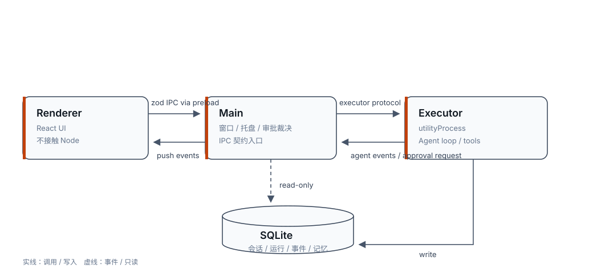
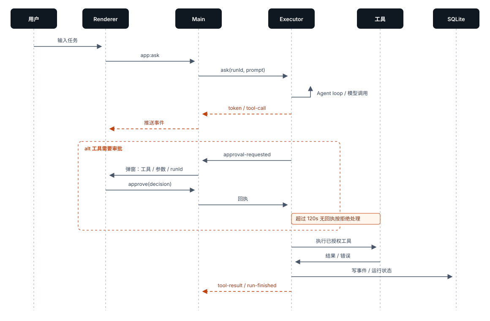

# AgentGuard 架构

> 本文解释 AgentGuard 为什么这样拆分进程、审批为什么跨进程、审计如何落盘，以及失败时系统如何收尾。  
> README 只保留摘要；这里是实现层面的设计说明。

## 1. 设计目标与非目标

### 目标

- **本地执行**：Agent 的工具调用发生在用户本机，不把执行放到远端。
- **最小权限**：每个会话绑定一个用户选择的目录，工具只能在该目录内操作。
- **人在回路**：写文件、执行命令等操作必须经过人工审批；没人确认就不执行。
- **可审计**：审批决定、工具调用、工具结果和运行结束形成可查询、可导出的审计链。
- **可恢复**：会话、消息、运行和事件持久化；重启后能恢复历史，未完成的运行不会假装成功。
- **可验证**：权限、审批、审计和执行链路有单测、e2e 与 Evals 覆盖。

### 非目标

- 多租户、云端沙箱、SaaS 化；
- 面向公众的安装包、自动更新服务和 API Key 配置界面；
- 替代模型能力本身；Agent 循环来自 `learn-claude-code-typescript`，本项目负责桌面端的运行与信任边界。

## 2. 进程模型

| 角色 | 运行位置 | 负责 | 不负责 |
| --- | --- | --- | --- |
| main | Electron 主进程 | 窗口、托盘、IPC、审批登记与裁决、更新检查、崩溃/退出收尾 | Agent 循环、工具执行 |
| preload | 渲染层沙箱桥 | 通过 `contextBridge` 暴露固定方法；从 `CONTRACTS` 派生 API | 业务逻辑、直接文件/命令访问 |
| renderer | Chromium 渲染层 | React 界面、会话/对话/审批/审计展示 | Node、文件系统、命令执行 |
| executor | `utilityProcess` | Agent 循环、模型调用、工具执行、审批等待、SQLite 写入 | 窗口、托盘、渲染层状态 |

关键约束：

- 渲染层不接触 Node，不能直接读文件、执行命令或决定审批结果；
- 主进程只做协调与裁决，不执行 Agent 工具；
- 执行器是唯一写入 SQLite 的角色；主进程持有只读连接；
- 执行器崩溃不影响主界面；启动时会把上次遗留的 `running` 运行标记为 `interrupted`。

## 3. 一次运行的时序

> 两张图都是预渲染 SVG，源文件在 `diagrams/*.mmd`；文档不再内嵌 Mermaid，避免 GitHub 打开时动态加载渲染器。

- 审批请求由执行器发出，主进程登记并驱动渲染层；
- 渲染层的决定回传主进程，再唤醒执行器；
- 执行器等待审批时阻塞的是该次 Agent 运行，不是 UI；
- 运行事件由执行器写入 SQLite，主进程/渲染层只读展示。

## 4. 权限模型

工具调用依次经过三道关：

| 阶段 | 判断者 | 结果 | 是否弹审批 |
| --- | --- | --- | --- |
| 硬拒绝 | 策略层（规则） | `deny`，直接拒绝 | 否 |
| 规则 | 策略层 | `allow` / `ask` / `deny` | `ask` 才进入下一关 |
| 人工审批 | 用户 | `once` / `session` / `deny` / `timeout` | 是 |

补充语义：

- `once`：只允许本次调用；
- `session`：本次会话内同类工具免审批，但**只按工具名授权，不扩大参数范围**；
- `deny` / `timeout`：工具不执行，写入 `tool-denied` 或 `approval-decided(deny)`；
- 审批超时固定为 120s，默认站在安全一侧；
- 审批状态由主进程登记，窗口刷新或重新出现时可以再拉待审批列表。

实现位置：

- 策略：`src/harness/permission.ts`
- 执行器审批等待：`src/executor/index.ts`
- 主进程审批登记：`src/main/approval-registry.ts`
- 契约与事件：`src/shared/approval.ts`、`src/shared/audit-event.ts`

## 5. 工作区边界

每个会话绑定一个 `workspaceRoot`，而不是全局隐藏目录：

- 新建会话时由系统目录选择器选择目录，标题默认取目录名；
- 主进程校验目录后发放**一次性 token**，渲染层创建会话时同时提交 `workspaceRoot` 与 token；
- token 使用后即失效，渲染层不能绕过选择器直接传任意路径；
- 工具路径解析后必须落在 `workspaceRoot` 内，越界直接拒绝；
- 换目录 = 新建会话，旧会话保留自己的目录记录；
- 开发态自动化可通过 `AGENTGUARD_WORKSPACE` 跳过对话框；该入口仅在 `!app.isPackaged` 时生效。

### 当前边界

路径判断当前是字符串层面的前缀检查：

- `resolve(root, target)` 后必须等于 `root` 或以 `root + sep` 开头；
- **符号链接仍可能绕过该检查**；这是当前已知缺口，若要覆盖需要基于 `realpath` 解析并补测试；
- 因此“工作区内”目前是路径字符串约束，不是完整的文件系统沙箱。

## 6. 审计与持久化

### 存储

SQLite + WAL；迁移只追加、不改历史项。主要表：

| 表 | 作用 |
| --- | --- |
| `conversations` | 会话标题、时间、`workspace_root`、软删标记 |
| `messages` | 会话消息（按写入顺序） |
| `runs` | 一次运行的 prompt、状态、开始/结束时间、错误 |
| `events` | 追加写的审计事件，按自增 id 排序 |
| `chunks` / `embeddings` | 会话/记忆的检索切块与向量 |
| `memories` | 跨会话结构化记忆 |

### 事件

审计事件是判别联合，而不是 `type + unknown payload`：

- `run-started`
- `approval-requested`
- `approval-decided`
- `tool-call`
- `tool-result`
- `tool-denied`
- `retrieval`
- `memory-used` / `memory-written` / `memory-deleted`
- `run-finished`
- `conversation-deleted`

每个事件带 `runId`、`conversationId` 和时间；审计页按当前会话过滤，支持导出 JSON。

### 启动与恢复

- 启动时执行迁移，并把上次仍在 `running` 的运行标记为 `interrupted`；
- 主进程随后只持有只读连接，写入统一由执行器完成；
- 会话删除保留墓碑，并清理派生检索数据；消息与运行记录按当前策略保留。

## 7. 失败模式

| 失败 | 表现 | 收尾 |
| --- | --- | --- |
| 执行器崩溃 | UI 仍可用；crash report 写出 | 启动时将遗留 `running` 标记 `interrupted` |
| 模型/网络错误 | 运行失败，界面显示错误 | `run-finished(failed)`，保留审计 |
| 审批超时 | 弹窗等待超过 120s | 按拒绝处理，工具不执行 |
| 用户拒绝 | 工具不执行 | 写入 `approval-decided(deny)` / `tool-denied` |
| 工具执行错误 | 结果标记 `isError` | 结果回灌模型，运行可继续或结束 |
| 用户取消 | 运行停止 | `run-finished(cancelled)` |
| 渲染层刷新 | 主进程/执行器继续 | 审批登记保留，界面可重新拉取 |

## 8. 关键取舍

| 决策 | 替代方案 | 为什么选它 | 代价 |
| --- | --- | --- | --- |
| 三进程 | 单进程 / Web Worker | 工具执行与 UI 隔离，崩溃不拖垮界面 | IPC 契约、跨进程审批复杂度 |
| 主进程裁决审批 | 执行器自己裁决 | 渲染层不可信，主进程更适合做唯一裁决点 | 多一次跨进程往返 |
| SQLite + WAL | JSON 文件 | 事务、查询、索引、崩溃恢复 | 原生模块、迁移管理 |
| 自定义 `app://` + CSP | `file://` | 限制页面来源与导航/新窗口 | 协议注册、开发态 HMR 需要单独放行 |
| 事件 ADT | 通用 `type + payload` | 类型安全、事件形状可校验 | 新事件需要改 schema |
| 源码展示、不做公开分发 | 发布安装包 | 项目定位是工程展示，不承诺生产支持 | 用户不能直接下载安装 |

## 9. 验证策略

- **单测/边界测试**：权限决策、审批状态、路径越界、审计事件、存储迁移；
- **Playwright e2e**：工作区、审批允许/拒绝、会话授权、硬拒绝、重启恢复、取消、模型错误；
- **Evals**：任务、策略、检索、记忆四类；mock 模式验证评测链路，real 模式只报告、不进 CI；
- **性能采样**：`npm run perf` / `npm run perf:render`，结果只代表本机，不作为通用基准。

测试与 e2e 验证的是工程链路，不是模型能力；mock/fake 只替换模型与 embedding，
权限、审批、工作区隔离和检索代码路径仍是生产实现。

## 10. 阅读顺序

1. `src/shared/contracts.ts`：三进程共享的 zod 契约与通道；
2. `src/executor/index.ts`：Agent 运行入口、审批等待、超时拒绝；
3. `src/harness/permission.ts`：硬拒绝 / 规则 / ask 的决策；
4. `src/main/ipc.ts`：IPC 注册、工作区 token、审批转发；
5. `src/renderer/hooks/useChat.ts`：新建会话、发送、事件订阅；
6. `src/harness/store/schema.ts`：SQLite 表与迁移。

目录级说明见 README 的「目录结构」。
